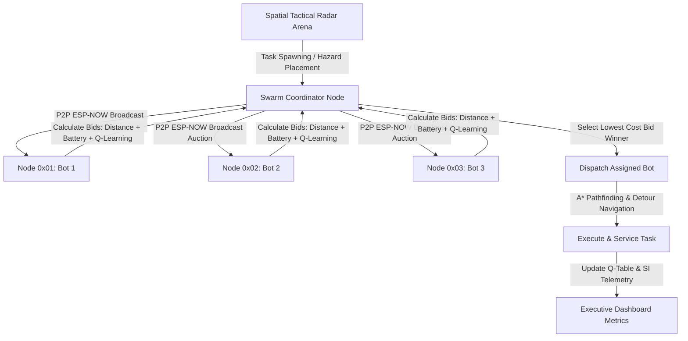

# CYBER-SWARM // Quantum Operations Hub
## Full System Architecture, Technical Documentation & Operational Guide

---

### Executive Summary

**CYBER-SWARM // Quantum Hub** is an advanced, real-time, browser-based web application and multi-agent simulation engine designed to simulate and manage an autonomous mesh swarm of ESP32 micro-robots. The platform integrates **Reinforcement Learning (Q-Learning)**, **P2P ESP-NOW Mesh Consensus Bidding**, **High-Precision A* Pathfinding with String-Pulling**, and **Smart Goal Projection** into a responsive, zero-page-scroll **Light Studio UX**.

---

### System Architecture Overview

---

### Key Architectural Modules

#### 1. Distributed P2P Mesh Topology & Leader Election
- **Communication Protocol**: Simulated low-latency **ESP-NOW P2P Mesh Network** ($30\text{m}$ range).
- **Coordinator Fitness Function**: Every $10\text{s}$ (or on node failure/low battery), the swarm dynamically elects a **Swarm Coordinator** based on node fitness:
  $$\text{Fitness} = (0.35 \cdot \text{Battery}) + (0.30 \cdot \text{Centrality}) + (0.20 \cdot \text{LoadScore}) + (0.15 \cdot \text{CommReliability})$$
- **Automatic Failover**: If the active Coordinator's battery falls below $20\%$, leadership automatically transfers to the next healthiest node.

---

### Artificial Intelligence & Algorithmic Foundations

#### A. Q-Learning Model-Free Reinforcement Learning
Each swarm node maintains a discrete Q-Table to optimize its bidding strategy over time.

- **State Space ($S$)**: Discretized environment state `B_Batt|D_Dist|Q_Queue`:
  - **Battery**: `LOW` ($<35\%$), `MED` ($35-70\%$), `HIGH` ($>70\%$)
  - **Distance**: `NEAR` ($<5\text{m}$), `MED` ($5-12\text{m}$), `FAR` ($>12\text{m}$)
  - **Queue Load**: `EMPTY` ($0$), `LIGHT` ($1$), `HEAVY` ($\ge 2$)
- **Action Space ($A$)**: Bidding Profile Multipliers (`[0.92, 1.00, 1.08]`):
  1. `AGGRESSIVE` ($0.92\times$) — Aggressively underbids to secure tasks.
  2. `MODERATE` ($1.00\times$) — Standard baseline bidding.
  3. `CONSERVATIVE` ($1.08\times$) — Higher bid to conserve power.
- **Bellman Equation Update**:
  $$Q(s, a) \leftarrow Q(s, a) + \alpha \left[ R + \gamma \max_{a'} Q(s', a') - Q(s, a) \right]$$
  - $\alpha = 0.20$ (Learning Rate)
  - $\gamma = 0.90$ (Discount Factor)
  - $\epsilon = 0.30 \to 0.05$ (Epsilon Decay exploration floor)
- **Reward Function ($R$)**:
  - $+10.0$ for completing task within target time & low energy.
  - $-10.0$ penalty for task drops/failures.

---

#### B. High-Precision A* Pathfinding & Raycast String-Pulling
- **Grid Resolution**: $0.3\text{m}$ fine grid ($66 \times 66$ cells over a $20\text{m} \times 20\text{m}$ arena).
- **Fast $O(1)$ Hash Map Traversal**: Solves complex maze corners in $<1\text{ms}$.
- **Corner Squeezing Prevention**: Checks orthogonal neighbor blockage for diagonal moves.
- **Raycast String-Pulling**: Smooths grid steps into direct line-of-sight vectors around obstacle corners.

---

#### C. Smart Goal Projection Algorithm (`findNearestSafePoint`)
- **Problem**: Tasks placed inside or directly adjacent to hazard walls can become obstructed.
- **Solution**: Evaluates concentric search rings ($0.3\text{m}$ to $4.0\text{m}$) outward from target coordinates to project the goal to the **nearest unblocked floor space**.
- **Background Rescue Dispatcher**: A background interval ($2.5\text{s}$) continuously re-evaluates queued tasks to ensure $100\%$ task resolution.

---

#### D. ESP32 Firmware Bidding Formula
Bids are calculated using the shared firmware cost function:
$$\text{Cost} = \left[ W_d \cdot \text{NormDistance} + W_b \cdot (1 - \text{Battery}\%) + W_s \cdot \text{StatusPenalty} \right] \cdot \text{PriorityMult}$$
- $W_d = 0.50$ (Distance Weight)
- $W_b = 0.30$ (Battery Loss Weight)
- $W_s = 0.20$ (Status Penalty Weight)
- **Priority Multiplier**: Normal ($1.0\times$), High ($0.8\times$), Emergency ($0.4\times$)

---

### Hardware Physics & Battery Dynamics

| Node State | Power Draw (Watts) | Simulation Drain Rate |
| :--- | :--- | :--- |
| **IDLE / Standby** | $0.5\text{ W}$ | $\approx 0.02\% / \text{sec}$ (Low background standby) |
| **MOVING** | $35.0\text{ W}$ | $\approx 1.1\% / \text{sec}$ (Active propulsion) |
| **SERVICING** | $18.0\text{ W}$ | $\approx 0.6\% / \text{sec}$ (Task execution dwell) |

- **Critical Threshold ($<20\%$)**: Triggers low battery alerts, drops active tasks to pending queue, and forces leader re-election.

---

### User Interface & Layout System

1. **Light Studio Theme Aesthetic**: Off-white background (`#f4f6fb`), crisp white surface cards (`#ffffff`), and slate dark contrast accents (`#0f172a`).
2. **Fixed Viewport Architecture**: `100vh` non-scrolling layout (`overflow: hidden`).
3. **Right Inspector Internal Scroll**: Dedicated scroll container (`.right-col`) holding all 5 telemetry panels without vertical page clipping.
4. **Dynamic Canvas Reticle Cursors**:
   - Cyan Target Crosshair for Task Placement.
   - Red Box Reticle for Hazard Walls.
   - Crimson X Cursor for Eraser.

---

### Summary Table of Core Files & Functions

| File / Symbol | Location | Function / Purpose |
| :--- | :--- | :--- |
| [index.html](file:///c:/Users/Hp/Desktop/AI%20+%20Design%20Experience/index.html) | Root | Single-page application code, styles, and markup |
| `findPathAStar()` | [index.html:L1130](file:///c:/Users/Hp/Desktop/AI%20+%20Design%20Experience/index.html#L1130) | High-speed $O(1)$ grid pathfinding with raycast smoothing |
| `findNearestSafePoint()` | [index.html:L1340](file:///c:/Users/Hp/Desktop/AI%20+%20Design%20Experience/index.html#L1340) | Smart Goal Projection for wall-adjacent targets |
| `calculateBid()` | [index.html:L1357](file:///c:/Users/Hp/Desktop/AI%20+%20Design%20Experience/index.html#L1357) | ESP32 cost formulation and Q-Learning action selection |
| `runAuction()` | [index.html:L1500](file:///c:/Users/Hp/Desktop/AI%20+%20Design%20Experience/index.html#L1500) | P2P Contract Net Protocol bidding execution |
| `updateSimulation()` | [index.html:L1660](file:///c:/Users/Hp/Desktop/AI%20+%20Design%20Experience/index.html#L1660) | Physics update loop, motion, battery drain, and rendering |
